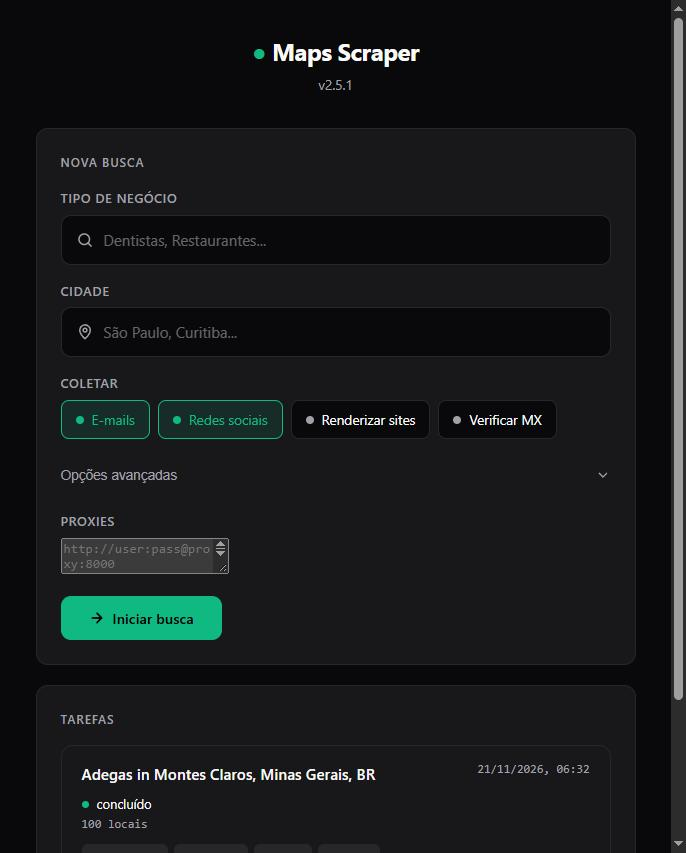

# 🗺️ Maps Scraper

Scraper de Google Maps para geração de leads. Extrai dados de negócios locais como **telefone, e-mail, website, redes sociais, avaliações** e mais — tudo rodando local, sem API key.


<p align="center">
  
</p>

---

## ✨ Funcionalidades

| Recurso | Descrição |
|---------|-----------|
| 📧 **E-mails** | Extrai e-mails dos sites dos negócios (homepage + páginas de contato) |
| 📱 **Redes Sociais** | Instagram, Facebook, LinkedIn, TikTok, YouTube e X |
| ⭐ **Avaliações** | Nota, quantidade de reviews e até 5 avaliações por local |
| 🔍 **Verificação MX** | Valida se o domínio do e-mail realmente existe |
| 🌐 **Grid Mode** | Ultrapassa o limite de ~120 resultados do Google Maps |
| 🖥️ **Web UI** | Interface web limpa em português em `localhost:8080` |
| 🔌 **Proxies** | Suporte a HTTP, HTTPS e SOCKS5 |
| 📊 **Exportação** | CSV (leads e completo) e JSON |

---

## 🚀 Início Rápido

### Pré-requisitos

- [Python 3.9+](https://www.python.org/downloads/) (marque "Add to PATH" ao instalar)
- [Google Chrome](https://www.google.com/chrome/) (ou deixe o engine baixar automaticamente)

### Instalação

```bash
git clone https://github.com/yRvtt/maps-scraper.git
cd maps-scraper
```

**Windows — um clique:**
```
iniciar.bat
```

**Manual:**
```bash
cp .env.example .env
pip install -r requirements-browser.txt    # opcional: Playwright
python scripts/engine.py start
```

Acesse **http://localhost:8080** e comece a buscar.

---

## 💻 Uso pelo Terminal

```bash
# Busca simples
py scripts/scrape.py "dentistas em São Paulo" --city "São Paulo, SP" --depth 5

# Cidade inteira (grid 3x3 = ~1000 resultados)
py scripts/scrape.py "academias em Curitiba" --city "Curitiba, PR" --grid 3

# Com avaliações
py scripts/scrape.py "restaurantes em Rio de Janeiro" --city "Rio de Janeiro, RJ" --reviews 3

# Sem redes sociais (mais rápido)
py scripts/scrape.py "advogados em Brasília" --city "Brasília, DF" --no-socials
```

---

## 📋 Campos Extraídos

| Campo | Exemplo |
|-------|---------|
| Nome | Clínica Odonto SP |
| Telefone | (11) 3456-7890 |
| E-mail | contato@clinica.com.br |
| Website | https://clinica.com.br |
| Categoria | Dentista |
| Endereço | Rua Augusta, 123 - São Paulo |
| Avaliação | 4.8 |
| Nº de Reviews | 342 |
| Instagram | @clinicasp |
| Facebook | /clinicasp |
| LinkedIn | /company/clinicasp |
| TikTok | @clinicasp |
| YouTube | /clinicasp |
| X (Twitter) | @clinicasp |

---

## ⚙️ Configuração

Edite o `.env` para customizar:

```env
SCRAPER_PORT=8080          # Porta do servidor
SCRAPER_API_KEY=           # Proteger com senha (opcional)
```

---

## 🛠️ Comandos do Engine

```bash
py scripts/engine.py start     # Inicia
py scripts/engine.py stop      # Para
py scripts/engine.py restart   # Reinicia
py scripts/engine.py status    # Verifica status
py scripts/engine.py jobs      # Lista tarefas
```

---

## 📁 Estrutura

```
maps-scraper/
├── engine/            # Motor do scraper (servidor, browser, jobs)
├── scripts/           # CLI (scrape.py, engine.py)
├── presets/           # Lista de profissões em pt-BR
├── iniciar.bat        # Setup automático Windows
├── .env.example       # Config padrão
└── docker-compose.yml # Alternativa com Docker
```

---

## 🐳 Docker (alternativa)

```bash
docker compose up -d
```

---

## 📄 Licença

Este projeto é baseado no [google-maps-scraper-kit](https://github.com/Mahanaicoach/google-maps-scraper-kit) (AGPL-3.0), com UI redesenhada e tradução completa para pt-BR.
